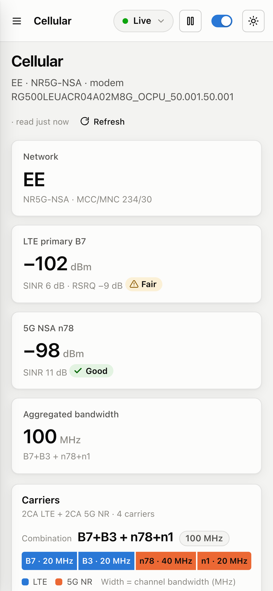

# Zyxel Insight

A local monitoring and diagnostics dashboard for the **Zyxel FWA505** 5G router. It collects what the router's own admin page only shows in the moment: signal and carrier history, connected devices, traffic, reboots and logs. It then turns that history into insights, such as configuration risks, reliability and actionable signal advice.

Insight runs on your own computer, talks only to your router, and is **strictly read-only**.


---

## Contents

- [Highlights](#highlights)
- [Screenshots](#screenshots)
- [Quick start](#quick-start)
- [Optional: real-time events from the router](#optional-real-time-events-from-the-router)
- [Safety and privacy](#safety-and-privacy)
- [Configuration](#configuration)
- [Accuracy and limitations](#accuracy-and-limitations)
- [Development](#development)
- [Troubleshooting](#troubleshooting)
- [Compatibility](#compatibility)

---

## Highlights

**History the router does not keep**

- **Log archive:** the router keeps only its last ~100 log lines in memory and loses them on reboot. Insight copies them continuously, deduplicates them and stores them in SQLite. Remote syslog can be added for complete history.
- **Signal history:** LTE and 5G RSRP, SINR and RSRQ every 5 seconds, plus per-carrier readings for every aggregated band.
- **Carriers and change events:** the active band combination (for example `B7+B3 + n78+n1`) and total aggregated bandwidth, with an event logged whenever a carrier or serving cell changes.
- **Reboots and outages:** reboots are detected from uptime, even ones that happen while Insight is stopped, and stamped with the real boot time. Periods when the router stopped answering are recorded as outages.
- **Devices:** first and last seen, connect and disconnect history, a new-device alert, and per-device Wi-Fi signal over time.
- **Traffic:** live throughput and daily data usage, computed from the router's interface counters.

**Insights the router does not provide**

- **Configuration audit:** 20 checks with a security score, covering remote management exposure, WPS, Wi-Fi security, DFS channels, UPnP, DMZ, SNMP, firmware updates and logging.
- **Reliability:** availability, outage durations, and reboots with or without a logged reason.
- **Signal health:** the share of time spent in Good, Fair and Poor signal on the router's own 5-bar scale, worst-10% values, 5G availability and time spent in each band combination.
- **Recommendations:** prioritised and specific, for example "B3 is 15 dB stronger than your primary B7" or "Phone has weak Wi-Fi".

**Every router page, read-only**

The router's admin sections (Broadband, Wireless, Home networking, Routing and NAT, QoS, Security, Remote access, VoIP, Maintenance) are mirrored with readable labels. Each section has a raw-JSON view.

**Professional UI**

- **Live:** updates arrive in about a second via Server-Sent Events, with a polling fallback.
- **Themes and layouts:** light and dark themes, plus a responsive layout for phones.
- **Shareable views:** filters are kept in the URL, logs export to CSV, and keyboard shortcuts (`/`, `j`/`k`, `Enter`, `Esc`) work throughout.

## Screenshots

<table>
  <tr>
    <td width="50%"><b>Insights</b>: audit, recommendations, signal health, reliability<br></td>
    <td width="50%"><b>Cellular</b>: carriers, band combination, signal history<br></td>
  </tr>
  <tr>
    <td><b>Devices</b>: presence and per-device Wi-Fi signal<br></td>
    <td><b>Traffic</b>: throughput and daily usage<br></td>
  </tr>
  <tr>
    <td><b>System</b>: load, reboots, outages, device details<br></td>
    <td><b>Router settings</b>: read-only mirror of the admin pages<br></td>
  </tr>
</table>

<p align="center"></p>

All screenshots use the bundled mock router and synthetic demo data. No real network data is shown.

## Quick start

**Requirements:** Node.js 22.9 or newer (Insight uses the built-in `node:sqlite`), and a Zyxel FWA505 reachable on your network.

```sh
npm install
cp .env.example .env     # then set ROUTER_PASSWORD
npm run build            # build the web UI
npm start                # open http://127.0.0.1:4400
```

To try Insight **without a router**, run the full stack against the bundled mock router:

```sh
npm run dev:mock     # UI with hot reload at http://localhost:5173
```

**Using the router's admin page while Insight runs:** press **Pause** in the top bar. Insight logs out and releases its router session. Press **Resume** afterwards.

## Optional: real-time events from the router

Insight works fully without these settings. They make two things better: log history survives router reboots, and reboots and link changes arrive instantly. The setup banner in the UI shows the exact values to enter.

| Router setting                | Value                                            | Effect                                                                      |
| ----------------------------- | ------------------------------------------------ | --------------------------------------------------------------------------- |
| Maintenance → Log Setting     | Remote server `<this computer's IP>`, UDP `5514` | Every log line reaches Insight as it is written                             |
| Maintenance → SNMP (optional) | Trap destination `<this computer's IP>:1162`     | Instant reboot and link up/down events; Insight re-reads status immediately |

Notes:

- **Load:** both are fire-and-forget UDP and put no measurable load on the router. If Insight is not running, the messages are simply dropped.
- **SNMP passwords:** enabling SNMP also starts the router's SNMP agent with the default communities `public` and `private`. Change the Get and Set communities if you enable it.
- **Stable IP:** reserve your computer's IP under Home Networking → Static DHCP. On macOS, set the Wi-Fi network's _Private Wi-Fi Address_ to _Fixed_ first, so the reservation keeps matching.

## Safety and privacy

- **Read-only by construction:**
  - **No writes:** the router client refuses every non-GET request except login and logout, and never calls `DEL_LOG`.
  - **Allowlist:** router data is read only from an explicit list of endpoints (`server/src/router/catalog.js`).
  - **Excluded endpoints:** endpoints that do work even on a GET are left out, including network and PLMN scans, ping and iperf tests, azimuth calibration, backup, the online firmware check and SMS.
- **Secrets never reach the browser:** the router returns some credentials in plain text, such as the Wi-Fi passphrase, SNMP communities and service passwords. They are masked on the server. The configuration audit runs on the raw values server-side.
- **Respects the router:**
  - **Lockout protection:** a rejected login halts collection instead of retrying, because the router locks the account after 3 failures.
  - **Pause:** releases the session, and nothing logs in while paused.
  - **Measured load:** about 19 requests per minute at idle, and under 50 per minute while someone browses every page. The admin page itself polls up to 60 per minute.
- **Local only:**
  - **Bound to localhost:** the server binds to `127.0.0.1` by default, and Insight has no login of its own. Keep it on localhost unless you add authentication in front of it.
  - **Ignored by git:** the database (`server/data/`) and `.env` are excluded.

## Configuration

All settings are environment variables, read from `.env` in the project root. See `.env.example`.

| Variable                            | Default                  | Purpose                                                              |
| ----------------------------------- | ------------------------ | -------------------------------------------------------------------- |
| `ROUTER_URL`                        | `https://192.168.1.1`    | Router address (self-signed certificate accepted for this host only) |
| `ROUTER_USER` / `ROUTER_PASSWORD`   | `admin` / none           | Router admin login                                                   |
| `POLL_INTERVAL_SEC`                 | `120`                    | How often the router log (last 100 lines) is read                    |
| `STATUS_INTERVAL_SEC`               | `5`                      | Signal, carriers and uptime                                          |
| `SYSLOG_PORT` / `SYSLOG_HOST`       | `5514` / `0.0.0.0`       | Remote syslog listener                                               |
| `SNMP_TRAP_PORT` / `SNMP_TRAP_HOST` | `1162` / `0.0.0.0`       | SNMP trap listener                                                   |
| `SNMP_COMMUNITY`                    | empty (any)              | Only accept traps with this community                                |
| `HOST` / `PORT`                     | `127.0.0.1` / `4400`     | Web UI and API                                                       |
| `DB_PATH`                           | `server/data/insight.db` | SQLite database (relative to the project root)                       |
| `RETAIN_LOGS_DAYS`                  | `180`                    | Log retention                                                        |
| `RETAIN_SIGNAL_DAYS`                | `90`                     | 5-second signal sample retention                                     |
| `RETAIN_WIFI_DAYS`                  | `30`                     | Per-device Wi-Fi sample retention                                    |

## Accuracy and limitations

- **Values come straight from the router:** they were verified against raw reads, and carrier bands, PCI, RSRP, aggregated bandwidth, uptime (within about 1 s) and Wi-Fi client RSSI all match.
- **Signal ratings use the router's own 5-bar RSRP scale,** taken from its web UI, so Insight and the admin page agree. SINR, which the router does not rate, uses standard LTE/NR guidance.
- **Reboot causes:**
  - **What Insight can know:** that the router restarted, and exactly when.
  - **What it cannot know:** why, unless the router's log says so. A crash, a power cut and a manual reboot look identical, which is why reboots show "no logged reason".
- **Memory includes cache:** the router reports total and free memory only, so "memory in use" includes reclaimable cache.
- **Temperature:** none is exposed by this firmware (web API or shell), so Insight does not show one.
- **History needs Insight running:** while the computer sleeps, only totals (data used, reboots) can be recovered afterwards. Run Insight on an always-on machine for complete history.

## Development

```sh
npm run dev          # server (watch) + web UI with hot reload
npm run dev:mock     # same, against the mock router
npm run check        # lint + format check + tests + production build
npm test             # unit tests (node:test)
```

### Mock router

`server/dev/mock-router.js` serves the same endpoints and response shapes as a real FWA505. The fixtures in `server/dev/fixtures/` were captured read-only from a real device, with credentials masked and identifiers replaced: MACs, serial number, IMEI, IMSI, ICCID, cell ID and network names.

### Project structure

```
shared/                 Domain rules shared by server and UI (signal scales, severities)
server/src/
  index.js              Composition root: wiring, startup, graceful shutdown
  router/               Read-only router client, endpoint allowlist, shared cache, secret masking
  collector/            Polling and recovery, radio and carrier interpretation, reboots, samplers
  ingest/               Syslog and SNMP trap listeners (shared UDP listener)
  logs/                 Router log and syslog parsing, sliding-window deduplication
  insights/             Configuration audit, statistics and recommendations
  storage/              SQLite schema, statement cache, one repository per area, retention
  events/               Server-Sent Events hub
  http/                 Express app, query parsing, one route module per API area
server/test/            Mirrors src/
server/dev/             Mock router and fixtures
web/src/
  app/                  Routing (History API), navigation model, live-data context
  api/                  The only module that knows API URLs
  hooks/                useAsync, useRouterData, useServerEvents, useUrlFilters, ...
  lib/                  Formatting, labels, chart series and ranges
  components/           ui/ (building blocks), charts/, shell/ (sidebar, top bar)
  features/             Dashboard- and cellular-specific components
  pages/                One component per route; settings/ mirrors the admin pages
  styles/               Tokens, base, layout, components, charts, pages
```

### Conventions

- **Language and tooling:** ES modules throughout, ESLint (flat config) and Prettier, enforced by `npm run check`.
- **Testable logic:** pure logic is separated from I/O and unit tested.
- **One way to do common things:** one API client and one data hook (`useAsync`). Colours, thresholds and ranges come from `shared/` and `web/src/lib/domain.js`, never hard-coded in components.

## Troubleshooting

| Symptom                                  | Cause and fix                                                                                                                                                              |
| ---------------------------------------- | -------------------------------------------------------------------------------------------------------------------------------------------------------------------------- |
| "Port 4400 is already in use"            | Another program uses the port. Set `PORT` in `.env`.                                                                                                                       |
| Collector shows **Halted**               | The router rejected the login. Fix `ROUTER_USER`/`ROUTER_PASSWORD`, then press **Retry login**. Insight does not retry on its own, to avoid the router's 3-strike lockout. |
| Admin page says "Duplicated login"       | Press **Pause** in Insight before using the admin page, and **Resume** afterwards.                                                                                         |
| Remote syslog stays "Not set up"         | Check the router's log server IP and port. Ports below 1024 need root on macOS, so use `5514`.                                                                             |
| A "gap" warning appears in the event log | Lines rolled out of the router's 100-line buffer between reads. Enable remote syslog or lower `POLL_INTERVAL_SEC`.                                                         |

## Compatibility

Developed and verified against a **Zyxel FWA505**, firmware **V1.71(ACKO.0)C0**, with a Quectel RG500L modem. Other Zyxel models that use the same web interface (the `DAL` API) may partly work. Field names are matched defensively, and unsupported endpoints are reported rather than failing.

---

Zyxel Insight is an independent project and is not affiliated with or endorsed by Zyxel. "Zyxel" and "FWA505" are used only to describe compatibility.
