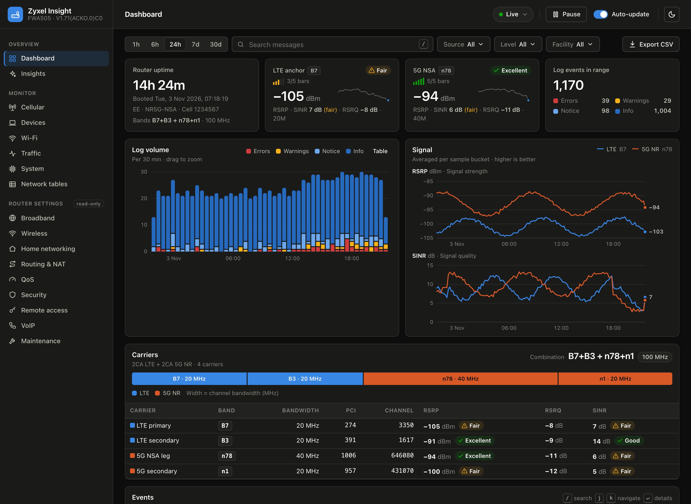
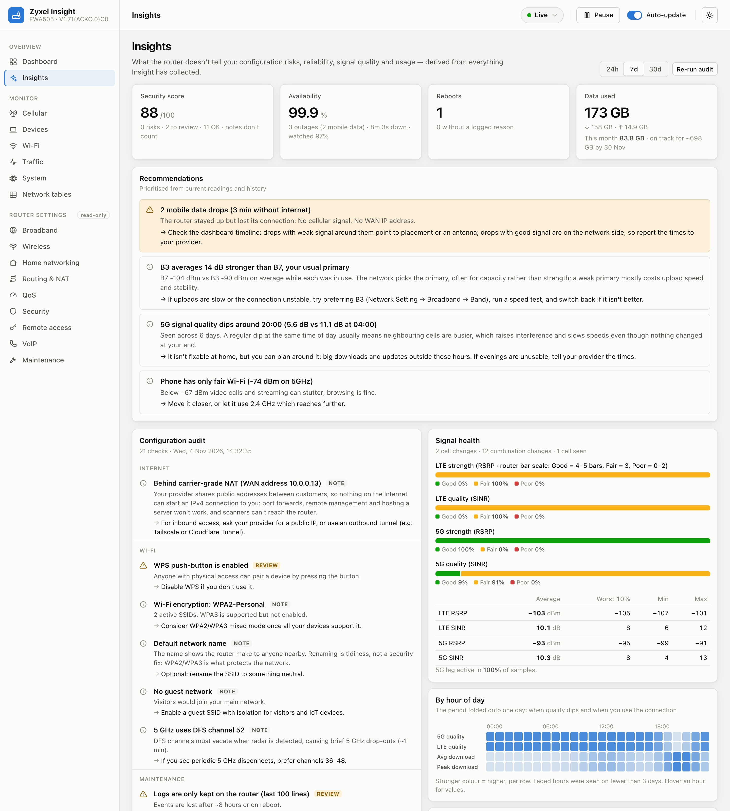
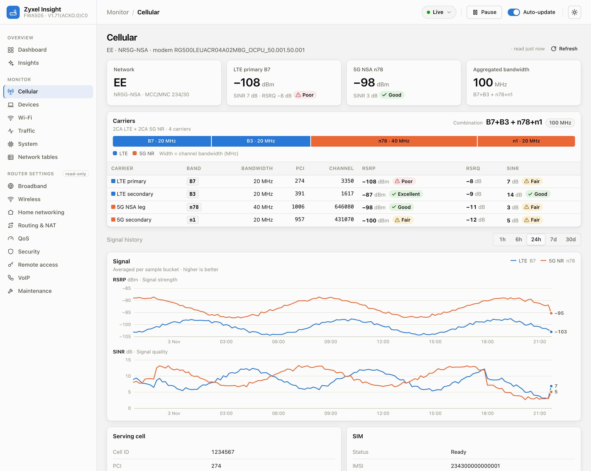
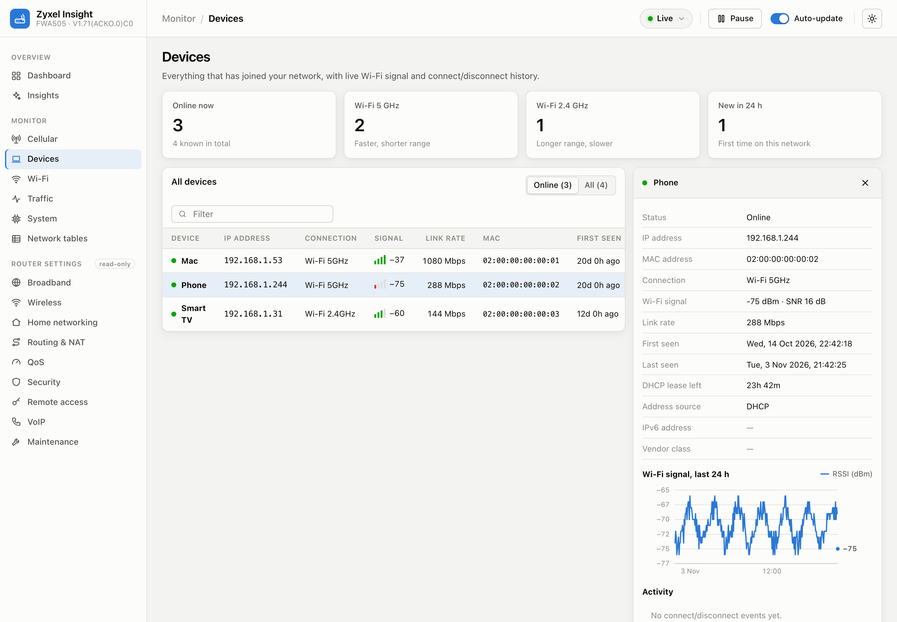
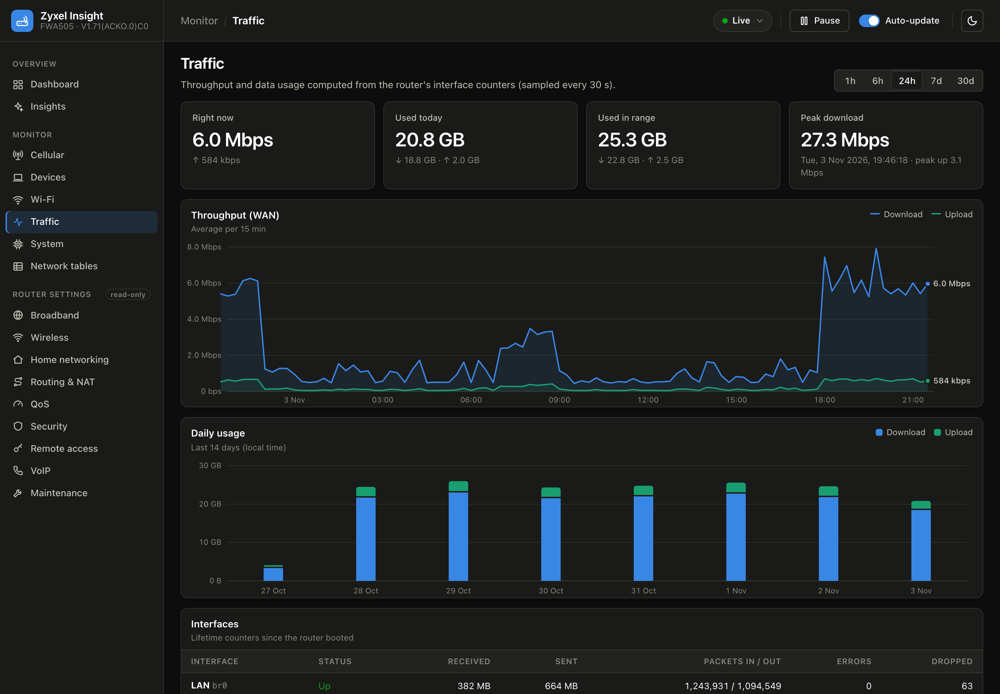
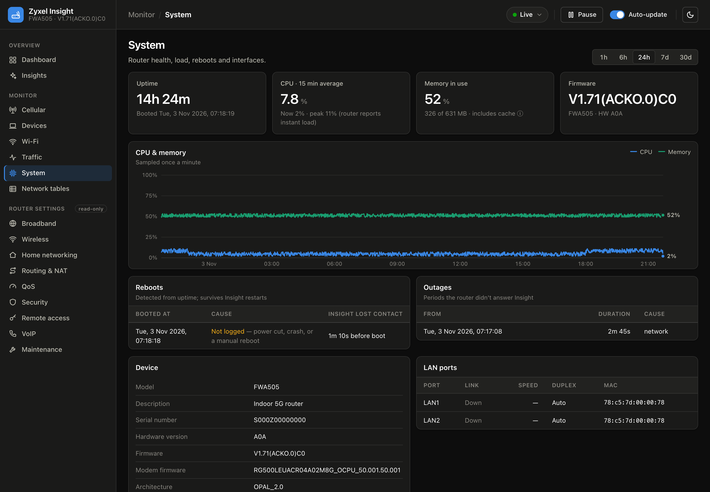
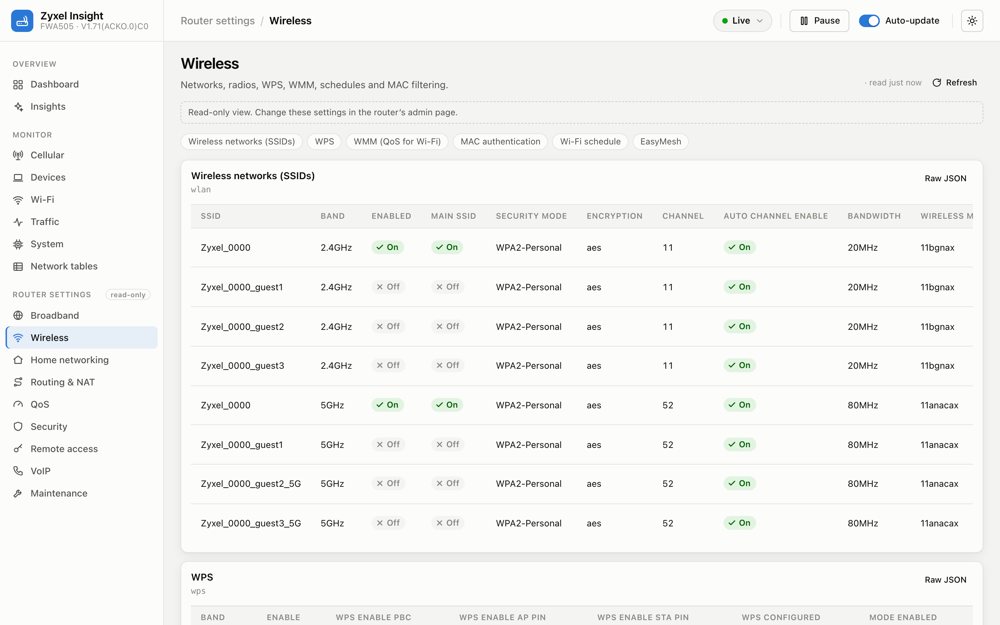
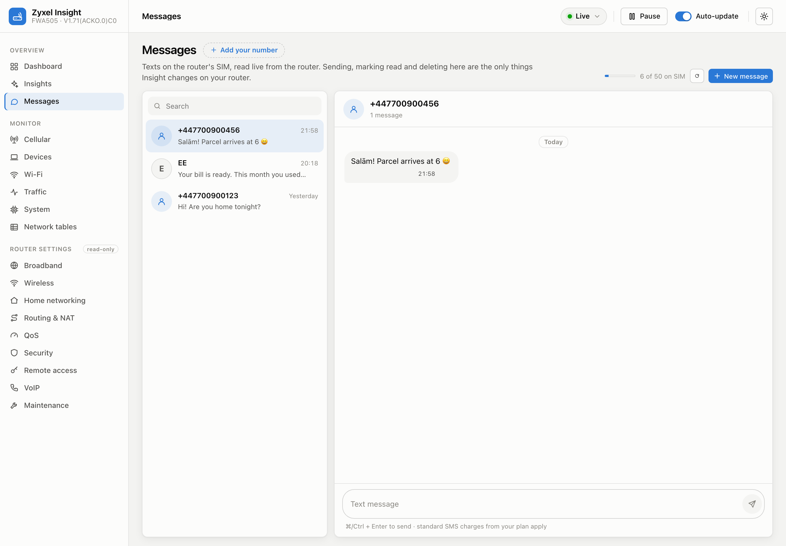
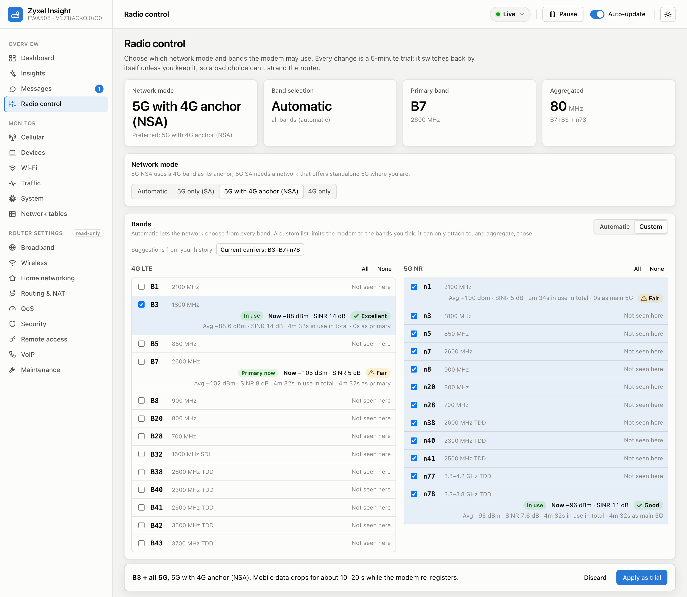

# Zyxel Insight

A local monitoring and diagnostics dashboard for the **Zyxel FWA505** 5G router. It collects what the router's own admin page only shows in the moment: signal and carrier history, connected devices, traffic, reboots and logs. It then turns that history into insights, such as configuration risks, reliability and actionable signal advice.

Insight runs on your own computer, talks only to your router, and is **read-only**, with two deliberate exceptions: the Messages tab can send, mark read and delete SMS on the router's SIM, and Radio control can change the preferred network mode and bands, always as a trial that reverts unless kept (`SMS_ENABLED=false` and `RADIO_CONTROL_ENABLED=false` turn them off).



---

## Contents

- [Highlights](#highlights)
- [Screenshots](#screenshots)
- [Quick start](#quick-start)
- [Optional: real-time events from the router](#optional-real-time-events-from-the-router)
- [Safety and privacy](#safety-and-privacy)
- [Configuration](#configuration)
- [Accuracy and limitations](#accuracy-and-limitations)
- [Development](#development)
- [Troubleshooting](#troubleshooting)
- [Compatibility](#compatibility)
- [License](#license)

---

## Highlights

**History the router does not keep**

- **Log archive:** the router keeps only its last ~100 log lines in memory and loses them on reboot. Insight copies them continuously, deduplicates them and stores them in SQLite. Remote syslog can be added for complete history.
- **Signal history:** LTE and 5G RSRP, SINR and RSRQ every 5 seconds, plus per-carrier readings for every aggregated band.
- **Carriers and change events:** the active band combination (for example `B7+B3 + n78+n1`) and total aggregated bandwidth, with an event logged whenever a carrier or serving cell changes.
- **Reboots and outages:** reboots are detected from uptime, even ones that happen while Insight is stopped, and stamped with the real boot time. Outages are recorded in two kinds: the router stopped answering Insight, or it answered but its mobile data connection was down (no SIM, cellular interface down, or no WAN address).
- **Devices:** first and last seen, connect and disconnect history, a new-device alert, and per-device Wi-Fi signal over time.
- **Traffic:** live throughput and daily data usage, computed from the router's interface counters.
- **Radio control:** choose the network mode (automatic, 5G SA, 5G NSA, 4G only) and which bands the modem may use, with each band's measured strength, quality and time in use beside it, and suggestions from that history (for example "strongest 4G + all 5G"). Every change is a 5-minute trial that switches back unless you keep it. Also shows the live carrier aggregation and the serving mast's eNodeB ID and sector, to look up on a coverage map.
- **Messages:** the SIM's texts as conversations, with replies, new messages, mark-as-read and delete, an unread badge in the sidebar, and a live character and SMS-part counter that uses the router's own encoding (GSM or Unicode, long messages split into parts).

**Insights the router does not provide**

- **Configuration audit:** 21 checks with a security score, covering whether the router is reachable from the Internet at all (carrier-grade NAT), remote management exposure, WPS, Wi-Fi security, DFS channels, UPnP, DMZ, SNMP, firmware updates and logging. Notes are facts and never move the score.
- **Connection timeline:** WAN throughput on the dashboard with outages, reboots, cell handovers and band changes marked on the same axis, so a slowdown lines up with its cause. Time Insight wasn't collecting is hatched as "not monitored" rather than passing for a quiet period. Click a marker to zoom to that moment and its logs.
- **Reliability:** availability, outage durations, and reboots with or without a logged reason.
- **Signal health:** the share of time spent in Good, Fair and Poor signal on the router's own 5-bar scale, worst-10% values, 5G availability, time spent in each band combination, and an hour-of-day profile of signal quality and download that shows busy-hour dips once there are a few days of data.
- **Recommendations:** prioritised and specific, based on history rather than a single reading, for example "B3 averages 15 dB stronger than B7, your usual primary", "Signal quality limits speed (5G 5.4 dB)", mobile data drops with their causes, or "Phone has weak Wi-Fi".
- **Usage:** data used per period, plus this month so far and where it's heading.

**Every router page, read-only**

The router's admin sections (Broadband, Wireless, Home networking, Routing and NAT, QoS, Security, Remote access, VoIP, Maintenance) are mirrored with readable labels. Each section has a raw-JSON view.

**Professional UI**

- **Live:** updates arrive in about a second via Server-Sent Events, with a polling fallback.
- **Themes and layouts:** light and dark themes, plus a responsive layout for phones.
- **Shareable views:** filters are kept in the URL, logs export to CSV, and keyboard shortcuts (`/`, `j`/`k`, `Enter`, `Esc`) work throughout.

## Screenshots

<table>
  <tr>
    <td width="50%"><b>Insights</b>: audit, recommendations, signal health, hour-of-day profile, usage<br></td>
    <td width="50%"><b>Cellular</b>: carriers, band combination, signal history<br></td>
  </tr>
  <tr>
    <td><b>Devices</b>: presence and per-device Wi-Fi signal<br></td>
    <td><b>Traffic</b>: throughput and daily usage<br></td>
  </tr>
  <tr>
    <td><b>System</b>: load, reboots, outages, device details<br></td>
    <td><b>Router settings</b>: read-only mirror of the admin pages<br></td>
  </tr>
  <tr>
    <td><b>Messages</b>: the SIM's texts as conversations, with replies and a live SMS-part counter<br></td>
    <td><b>Radio control</b>: network mode and bands, with live and average readings per band, as trials that revert unless kept<br></td>
  </tr>
</table>

All screenshots use the bundled mock router and synthetic demo data. No real network data is shown.

## Quick start

**Requirements:** Node.js 22.13 or newer (Insight uses the built-in `node:sqlite`), and a Zyxel FWA505 reachable on your network.

```sh
npm install
cp .env.example .env     # then set ROUTER_PASSWORD
npm run build            # build the web UI
npm start                # open http://127.0.0.1:4400
```

To try Insight **without a router**, run the full stack against the bundled mock router:

```sh
npm run dev:mock     # UI with hot reload at http://localhost:5173
```

**Using the router's admin page while Insight runs:** press **Pause** in the top bar. Insight logs out and releases its router session. Press **Resume** afterwards.

## Optional: real-time events from the router

Insight works fully without these settings. They make two things better: log history survives router reboots, and reboots and link changes arrive instantly. The setup banner in the UI shows the exact values to enter.

| Router setting                | Value                                            | Effect                                                                      |
| ----------------------------- | ------------------------------------------------ | --------------------------------------------------------------------------- |
| Maintenance → Log Setting     | Remote server `<this computer's IP>`, UDP `5514` | Every log line reaches Insight as it is written                             |
| Maintenance → SNMP (optional) | Trap destination `<this computer's IP>:1162`     | Instant reboot and link up/down events; Insight re-reads status immediately |

Notes:

- **Load:** both are fire-and-forget UDP and put no measurable load on the router. If Insight is not running, the messages are simply dropped.
- **SNMP passwords:** enabling SNMP also starts the router's SNMP agent with the default communities `public` and `private`. Change the Get and Set communities if you enable it.
- **Stable IP:** reserve your computer's IP under Home Networking → Static DHCP. On macOS, set the Wi-Fi network's _Private Wi-Fi Address_ to _Fixed_ first, so the reservation keeps matching.

## Safety and privacy

- **Read-only by construction, with two exceptions:**
  - **No writes:** the router client refuses every non-GET request except login, logout, SMS and the band selection, and never calls `DEL_LOG`.
  - **The SMS exception:** `POST`/`PUT`/`DELETE` are allowed to exactly one endpoint, `/cgi-bin/DAL?oid=cellwan_sms`, with a fixed set of parameters, and only while `SMS_ENABLED` is on (the default). That's how the Messages tab sends, marks read and deletes texts. It can't be pointed at any other setting. Sends are never retried (a retry could text twice), are limited to 5 a minute and 30 an hour, and each send or delete is logged with the number partly masked and without the text.
  - **The band-selection exception:** `PUT` is allowed to exactly one endpoint, `/cgi-bin/DAL?oid=cellwan_band`, with nothing else on the URL, and only while `RADIO_CONTROL_ENABLED` is on (the default). The body is the router's own object with only the network mode and band list changed, checked first against the same rules as the router's admin page (for example, 5G NSA keeps at least one 4G and one 5G band). Each change is a trial: unless you press **Keep** within 5 minutes, Insight puts back the previous selection, also after a restart, and retries until the router accepts it. Changes are at least 15 s apart so the modem can re-register, and each one is logged.
  - **What it can't do:** cell (PCI) lock isn't offered: firmware V1.71 hides it and returns nothing for it. Carrier aggregation has no setting at all; the network decides it.
  - **Messages aren't stored:** they're read live from the SIM; Insight keeps no copy, and the router cache skips them. While the dashboard is open, the inbox is checked once a minute for the unread badge.
  - **Allowlist:** router data is read only from an explicit list of endpoints (`server/src/router/catalog.js`).
  - **Excluded endpoints:** endpoints that do work even on a GET are left out, including network and PLMN scans, ping and iperf tests, azimuth calibration, backup and the online firmware check.
- **Secrets never reach the browser:** the router returns some credentials in plain text, such as the Wi-Fi passphrase, SNMP communities and service passwords. They are masked on the server. The configuration audit runs on the raw values server-side.
- **Respects the router:**
  - **Lockout protection:** a rejected login halts collection instead of retrying, because the router locks the account after 3 failures.
  - **Pause:** releases the session, and nothing logs in while paused.
  - **Measured load:** about 19 requests per minute at idle, and under 50 per minute while someone browses every page. The admin page itself polls up to 60 per minute.
- **Local by default, password on the LAN:**
  - **Bound to localhost:** the server binds to `127.0.0.1` by default. To open it to other devices, set `HOST=0.0.0.0` (or a LAN IP) **and** `DASHBOARD_PASSWORD`; Insight refuses to start on a non-loopback address without a password.
  - **Login:** with `DASHBOARD_PASSWORD` set, every page, API call and live stream needs HTTP Basic auth. The username is ignored (use `insight`). The browser asks once and reuses it. Use it on a trusted LAN only: Basic auth over plain HTTP can be sniffed, so put a TLS reverse proxy in front for anything wider, and never forward the port from the internet.
  - **Browser protections:** requests must use a known host name (localhost, this machine's IPs and hostname, `ALLOWED_HOSTS`), which blocks DNS-rebinding pages. Requests that change state (Pause/Resume, sending and deleting SMS, band changes) need an `X-Insight-Request` header and a same-origin `Origin`, so other sites cannot trigger them. Responses carry a strict Content-Security-Policy, `X-Frame-Options: DENY`, `nosniff` and `no-referrer`.
  - **Router load caps:** at most 30 endpoints per `/api/router` request, a forced refresh (`fresh=1`) at most once per 10 s per endpoint (30 s for Insights), and at most 20 live (SSE) connections.
  - **Syslog and SNMP listeners:** they bind to `0.0.0.0` so the router can reach them, but only accept packets from the router (the host in `ROUTER_URL`) and loopback, unless `INGEST_ALLOWED_SOURCES` says otherwise. Stored rows are capped at 600 syslog lines and 60 traps per minute; denied and dropped packets are counted in the status and warnings are logged at most once a minute.
  - **Ignored by git:** the database (`server/data/`, including `backups/`) and `.env` are excluded.
- **Health and backups:** `GET /api/health` returns 200 while collecting (or paused) and 503 when login is halted or no router read succeeded for 3 × max(`STATUS_INTERVAL_SEC`, 60 s). It needs the password like everything else, except from the same machine (loopback), so systemd or a local monitor can probe it. A copy of the database is written every `BACKUP_EVERY_DAYS` (default 7) to `<DB dir>/backups/insight-YYYY-MM-DD.db` (newest `BACKUP_KEEP` kept); weekly by default because each backup copies the whole database, which matters on an SD card. On an unexpected error Insight logs out of the router and exits with code 1, so a supervisor such as systemd can restart it.

See [SECURITY.md](SECURITY.md) for the threat model and how to report a vulnerability.

## Configuration

All settings are environment variables, read from `.env` in the project root. See `.env.example`.

| Variable                            | Default                  | Purpose                                                                                                                         |
| ----------------------------------- | ------------------------ | ------------------------------------------------------------------------------------------------------------------------------- |
| `ROUTER_URL`                        | `https://192.168.1.1`    | Router address (self-signed certificate accepted for this host only)                                                            |
| `ROUTER_USER` / `ROUTER_PASSWORD`   | `admin` / none           | Router admin login                                                                                                              |
| `POLL_INTERVAL_SEC`                 | `120`                    | How often the router log (last 100 lines) is read                                                                               |
| `STATUS_INTERVAL_SEC`               | `5`                      | Signal, carriers and uptime                                                                                                     |
| `SYSLOG_PORT` / `SYSLOG_HOST`       | `5514` / `0.0.0.0`       | Remote syslog listener                                                                                                          |
| `SNMP_TRAP_PORT` / `SNMP_TRAP_HOST` | `1162` / `0.0.0.0`       | SNMP trap listener                                                                                                              |
| `SNMP_COMMUNITY`                    | empty (any)              | Only accept traps with this community                                                                                           |
| `INGEST_ALLOWED_SOURCES`            | the router's address     | Comma-separated IPs/hostnames allowed to send syslog and traps; `*` = anyone (loopback always allowed)                          |
| `HOST` / `PORT`                     | `127.0.0.1` / `4400`     | Web UI and API                                                                                                                  |
| `DASHBOARD_PASSWORD`                | empty (no login)         | HTTP Basic password, any username. Required when `HOST` is not loopback                                                         |
| `ALLOWED_HOSTS`                     | empty                    | Extra host names the UI may be opened by (DNS name, reverse proxy)                                                              |
| `SMS_ENABLED`                       | `true`                   | Messages tab: read, send and delete SMS on the router's SIM                                                                     |
| `RADIO_CONTROL_ENABLED`             | `true`                   | Radio control: change the preferred network mode and bands, as trials. With `SMS_ENABLED=false` too, Insight is fully read-only |
| `DB_PATH`                           | `server/data/insight.db` | SQLite database (relative to the project root)                                                                                  |
| `RETAIN_LOGS_DAYS`                  | `180`                    | Log retention                                                                                                                   |
| `RETAIN_SIGNAL_DAYS`                | `90`                     | 5-second signal sample retention                                                                                                |
| `RETAIN_WIFI_DAYS`                  | `30`                     | Per-device Wi-Fi sample retention                                                                                               |
| `BACKUP_KEEP`                       | `4`                      | Database backups kept in `<DB dir>/backups/` (`0` = off)                                                                        |
| `BACKUP_EVERY_DAYS`                 | `7`                      | Days between database backups                                                                                                   |

## Accuracy and limitations

- **Values come straight from the router:** they were verified against raw reads, and carrier bands, PCI, RSRP, aggregated bandwidth, uptime (within about 1 s) and Wi-Fi client RSSI all match.
- **"No measurement" is not a reading:** the modem reports placeholders such as `-128` when it has nothing to measure. Those, and anything outside the 3GPP measurement ranges, are dropped rather than stored, so they can't show up as impossible minimums.
- **Mobile data vs. the router:** the router answering on the LAN says nothing about the internet behind it, so mobile data is judged separately from the SIM state, cellular interface and WAN address. A drop of either kind is an outage; only "router unreachable" also leaves a gap in the signal history.
- **Signal ratings use the router's own 5-bar RSRP scale,** taken from its web UI, so Insight and the admin page agree. SINR, which the router does not rate, uses standard LTE/NR guidance.
- **Reboot causes:**
  - **What Insight can know:** that the router restarted, and exactly when.
  - **What it cannot know:** why, unless the router's log says so. A crash, a power cut and a manual reboot look identical, which is why reboots show "no logged reason".
- **Memory includes cache:** the router reports total and free memory only, so "memory in use" includes reclaimable cache.
- **Temperature:** none is exposed by this firmware (web API or shell), so Insight does not show one.
- **History needs Insight running:** while the computer sleeps, only totals (data used, reboots) can be recovered afterwards, and charts hatch that time as "not monitored". Run Insight on an always-on machine for complete history.

## Development

```sh
npm run dev          # server (watch) + web UI with hot reload
npm run dev:mock     # same, against the mock router
npm run check        # lint + format check + tests + production build
npm test             # unit tests (node:test)
```

### Mock router

`server/dev/mock-router.js` serves the same endpoints and response shapes as a real FWA505. The fixtures in `server/dev/fixtures/` were captured read-only from a real device, with credentials masked and identifiers replaced: MACs, serial number, IMEI, IMSI, ICCID, cell ID and network names.

The mock keeps a band selection that Radio control can change. It also has an SMS inbox (GSM, Unicode and a named sender) that receives a new text every 7 minutes, and accepts sends, marking read and deletes, so the Messages tab can be tried without touching a real SIM.

To exercise mobile-data outages, set `MOCK_WAN_DROP=<down>/<cycle>` in seconds, for example `MOCK_WAN_DROP=90/600 npm run mock -w server`: the router stays reachable but loses its WAN address for 90 s out of every 600 s.

### Project structure

```
shared/                 Domain rules shared by server and UI (signal scales, severities, SMS encoding, band rules)
server/src/
  index.js              Composition root: wiring, startup, graceful shutdown
  router/               Router client (read-only plus SMS and band selection), endpoint allowlist, shared cache, secret masking
  collector/            Polling and recovery, radio and carrier interpretation, mobile data state, reboots, samplers
  ingest/               Syslog and SNMP trap listeners (shared UDP listener)
  logs/                 Router log and syslog parsing, sliding-window deduplication
  insights/             Configuration audit, statistics, recommendations, timeline and monitored coverage
  sms/                  Messages: live SIM inbox, send, mark read, delete, send limits
  radio/                Band selection: validation, trials that revert unless kept
  storage/              SQLite schema, statement cache, one repository per area, retention
  events/               Server-Sent Events hub
  http/                 Express app, query parsing, one route module per API area
server/test/            Mirrors src/
server/dev/             Mock router and fixtures
web/src/
  app/                  Routing (History API), navigation model, live-data context
  api/                  The only module that knows API URLs
  hooks/                useAsync, useRouterData, useServerEvents, useUrlFilters, ...
  lib/                  Formatting, labels, chart series and ranges
  components/           ui/ (building blocks), charts/, shell/ (sidebar, top bar)
  features/             Dashboard-, cellular- and insights-specific components
  pages/                One component per route; settings/ mirrors the admin pages
  styles/               Tokens, base, layout, components, charts, pages
```

### Conventions

- **Language and tooling:** ES modules throughout, ESLint (flat config) and Prettier, enforced by `npm run check`.
- **Testable logic:** pure logic is separated from I/O and unit tested.
- **One way to do common things:** one API client and one data hook (`useAsync`). Colours, thresholds and ranges come from `shared/` and `web/src/lib/domain.js`, never hard-coded in components.

## Troubleshooting

| Symptom                                  | Cause and fix                                                                                                                                                              |
| ---------------------------------------- | -------------------------------------------------------------------------------------------------------------------------------------------------------------------------- |
| "Unknown host name" (421)                | You opened Insight by a name it does not know. Add it to `ALLOWED_HOSTS`.                                                                                                  |
| "Port 4400 is already in use"            | Another program uses the port. Set `PORT` in `.env`.                                                                                                                       |
| Collector shows **Halted**               | The router rejected the login. Fix `ROUTER_USER`/`ROUTER_PASSWORD`, then press **Retry login**. Insight does not retry on its own, to avoid the router's 3-strike lockout. |
| Admin page says "Duplicated login"       | Press **Pause** in Insight before using the admin page, and **Resume** afterwards.                                                                                         |
| Remote syslog stays "Not set up"         | Check the router's log server IP and port. Ports below 1024 need root on macOS, so use `5514`.                                                                             |
| No **Messages** tab                      | `SMS_ENABLED=false` is set. Remove it (or set `true`) and restart Insight.                                                                                                 |
| No **Radio control** tab                 | `RADIO_CONTROL_ENABLED=false` is set. Remove it (or set `true`) and restart Insight.                                                                                       |
| A "gap" warning appears in the event log | Lines rolled out of the router's 100-line buffer between reads. Enable remote syslog or lower `POLL_INTERVAL_SEC`.                                                         |

## Compatibility

Developed and verified against a **Zyxel FWA505**, firmware **V1.71(ACKO.0)C0**, with a Quectel RG500L modem. Other Zyxel models that use the same web interface (the `DAL` API) may partly work. Field names are matched defensively, and unsupported endpoints are reported rather than failing.

## License

Released under the [MIT License](LICENSE).

---

Zyxel Insight is an independent project and is not affiliated with or endorsed by Zyxel. "Zyxel" and "FWA505" are used only to describe compatibility.
